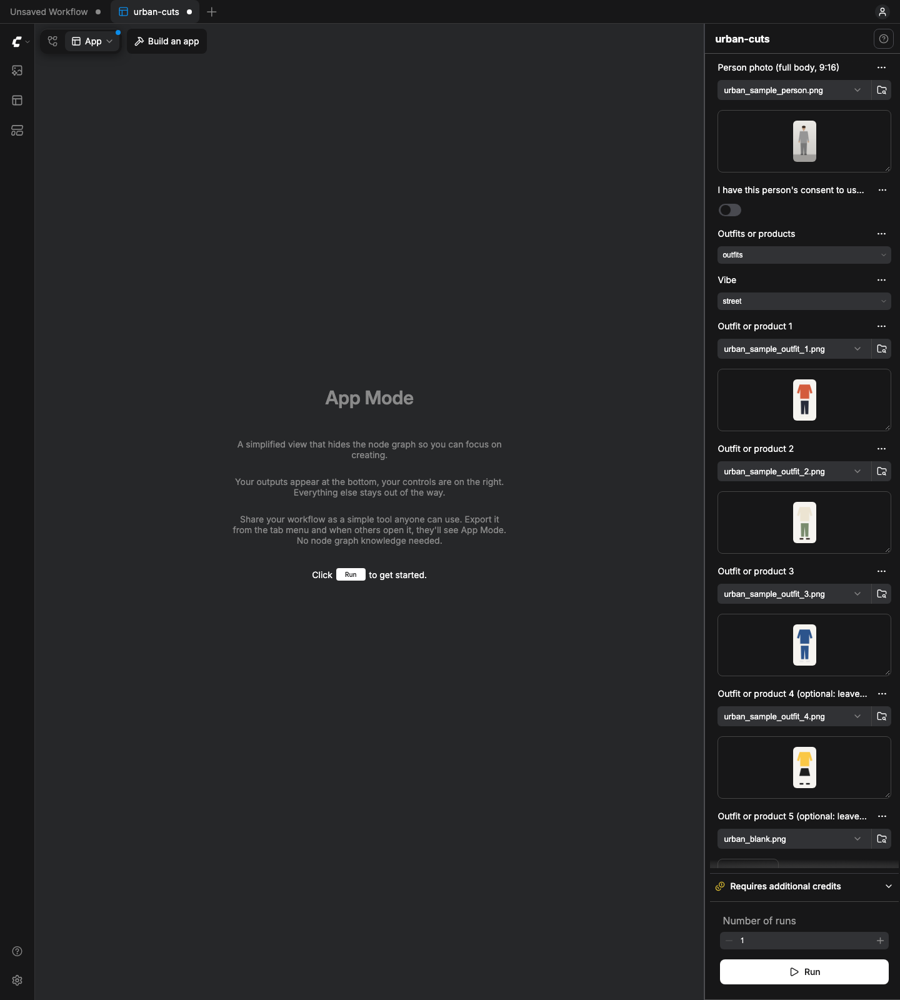

# Urban Cuts for ComfyUI

An open clone of Higgsfield's **Urban Cuts** app, built as a ComfyUI App Mode workflow. Give it one photo of a person,
3 to 5 outfits (or products) and a piece of music. It dresses the person in each look, moves each look into a bright
white wall room, films the model posing (hand on hip, a turn to the back, a look over the shoulder) plus a fabric
close-up, and cuts a 15 s 9:16 reel on the beat that loops.



Entry for Comfy's [Open Source Higgsfield](https://comfy.org/open-source-higgsfield) challenge (category: Most Viral).
Apache-2.0.

## What you get

- `Your reel`: an H.264 + AAC MP4 at 9:16 (or 4:5 / 1:1). In the default **brand** style:
  - **Teaser:** one beat of every look first, so the whole range shows in the first 2 seconds.
  - **Each look:** two shots from one Kling generation, cut on the beat: a 4-beat pose sequence on a locked camera
    (the model moves, not the camera) and a 2-beat handheld close-up on the fabric.
  - **Clean:** plain hard cuts, a warm natural grade with light grain, a short opening title over plain wall (the first ~4 s) and a small
    item name on each look (prices optional).
  - **Ending:** a 1 s card in the set's own wall colour with your shop name and @handle, then it loops.
  - Sound is -14 LUFS with true peak under -1 dBTP, and an `AI-generated` label is on by default.
- `Contact sheet`: the looks, plus one frame per cut with its time and effect.
- `Receipt`: JSON with BPM, beat times, the cut list, the partner calls made and their cost.
- `Beats`: BPM and beat times, as text.

**Why brand style:** we watched 15 recent outfit Shorts from top fashion brands (6 from a big fast-fashion label, plus
others). Across all 15 there were no flashes, whip pans, punch-zooms, prices or lineup grids. They use a locked camera
with the model posing in a real-looking room, plain hard cuts, the range up front and one short line of text. Brand
style copies those editing patterns. No brand assets are used.

**Hype style** (one switch) keeps the louder edit: a punch-zoom, flash or whip on each cut, a speed ramp into each cut,
a glow-up hit from a before photo, a beat pulse, numbered name-and-price tags and a lineup grid ending ("Comment a
number to shop"). It films a 360 turnaround instead of the pose sequence.

Two modes:
- **Outfits**: the person wears each outfit.
- **Products**: the person presents each product, a "new arrivals" reel for a shop.

Three vibes (`street`, `runway`, `boutique`) set the moves, the energy and the default music.

**Form options:**
- **Style:** brand or hype.
- **Set:** the white wall room (a Nano Banana 2.1 edit of each finished look, about $0.05 each), or keep your photo's
  own background.
- **Opening:** a teaser of every look, before→after, or off.
- **Ending:** the handle card (brand), the lineup grid, or neither (the last look loops back).
- **Two shots per look:** on by default. Off = one 3 s move per look, 10 s reels, the cheapest run.
- **Text:** headline, look names (one line per look, `Rust bomber | $89`), show prices, shop name, @handle, call to
  action, logo (lineup).
- Notes: the back of a garment is the model's guess unless your outfit photo shows it, and footwear not in the outfit
  is invented.

**Consistency:**
- **Background lock:** with Kling try-on the motion prompt locks the background, so the person stays in their own photo's setting.
- **Exposure match:** every look's brightness is matched to look 1 (measured on the background), so cuts don't
  flicker. It is one gain for all three channels, so garment colours stay exactly as generated (navy stays navy).
- **Drift guard:** a shot is cut off where its background drifts away from its first frame (checked per camera angle).
- All three are noted in the receipt.

## How it works

| Step | Node | Runs on |
|---|---|---|
| Choices + consent gate | `Urban Cuts: Your Choices + Consent` | CPU, free |
| Try-on per look | `Kling Virtual Try-On` (or `Nano Banana 2.1` edit; products always use Nano Banana 2.1) | Comfy partner API |
| Set per look | `Nano Banana 2.1` edit into the white wall room (`Urban Cuts: Set` picks it or your photo; only the picked one runs) | Comfy partner API |
| Motion per look | `Kling 3.0 Video`, image to video, 720p, no audio: 2 storyboards (3 s pose sequence or turnaround + 2 s close-up), or one 3 s move | Comfy partner API |
| Music | your uploaded track, or `Sonilo Text to Music` | upload: free / Sonilo: partner API |
| Beat Detect | `Urban Cuts: Beat Detect` (librosa if installed, else a numpy onset envelope + dynamic-programming beat tracker) | CPU, free |
| Beat Cut Assemble | `Urban Cuts: Beat Cut Assemble` (numpy frame effects + ffmpeg) | CPU, free |

The pack avoids paying for steps it doesn't use:
- Unused branches are **lazy inputs**. When you pick Kling try-on, the Nano Banana node never runs; when you keep your
  photo's background, the room edit never runs.
- With your own track, Sonilo never runs.
- A slot left on `urban_blank.png` skips that look's try-on and video.
- The consent switch sits in front of every node, so a run with it off stops before anything is generated.
- Seeds are fixed. A re-run after one failed shot reuses the finished (already paid) steps from ComfyUI's cache.

**Free Draft** (`workflows/urban-cuts-draft.json`) uses the same edit with no partner nodes. You give it a photo per
look; it adds a Ken Burns push and the same beat cuts. Use it to try music, vibe and length for $0.

Reused from Comfy's own templates rather than rebuilt:
- the Sonilo wiring follows `api_sonilo_v2m`
- the try-on edit prompt wording follows `template_eric_seedance_5_subject_and_outfit_combine` (Image 1 = identity, Image 2 = the outfit, exactly)

## Cost

Prices come from the nodes' own price badges (ComfyUI 0.42 `comfy_api_nodes`, read 2026-10-29). The `Receipt` output
gives the same estimate for each run.

| Partner call | Unit price | Default run (4 looks, 15 s, room, two shots) | Cheapest (4 looks, 10 s, own background, one move) |
|---|---|---|---|
| Kling Virtual Try-On | $0.16016 per image | 4 × = $0.641 | 4 × = $0.641 |
| Nano Banana 2.1 edit, 1K, minimal thinking: room set | $0.048048 per image | 4 × = $0.192 | none |
| Nano Banana 2.1 edit instead of try-on (fallback / products) | $0.048048 per image | (instead of try-on: 4 × = $0.192) | (4 × = $0.192) |
| Kling 3.0 video, `kling-v3`, 720p, no audio | $0.084 per second | 4 × 5 s = $1.68 | 4 × 3 s = $1.008 |
| Sonilo Text to Music | $0.0025 per second | 20 s = $0.05 | 15 s = $0.038 |
| **Total** | | **$2.56** with Kling try-on | **$1.69** (**$1.23** with Nano Banana) |
| Free Draft | | **$0** |

## Install

You need:
- ComfyUI 0.42+ with frontend 1.41+ (App Mode)
- `ffmpeg` on PATH
- `numpy` and Pillow (already in ComfyUI)
- optional: `librosa`

There are no model downloads and no GPU. Generation runs on Comfy's partner API (main app) or not at all (draft app).

```bash
cd ComfyUI/custom_nodes
git clone <this repo> urban-cuts
python urban-cuts/tools/make_samples.py --input-dir ../input    # sample inputs for the draft app (optional)
```

Restart ComfyUI and open `workflows/urban-cuts.json` (or `urban-cuts-draft.json`). It opens in App Mode. Then:
1. Tick **I have this person's consent**.
2. Pick your photos and music.
3. Press **Run**.

Partner nodes need a Comfy account with credits.

## Rules the app keeps

- **Consent:** the run stops unless you confirm that you have the person's consent to use their photo (or it's you).
- **Music:** use a track you own or have licensed, or generate one with Sonilo. Never a trending or copyrighted song.
- **Labelling:** keep the AI label on when you post. The draft labels itself `Free draft`.
- **Prompts:** the generation prompts ask for no logos, brand names or text, and no other people.

## Demo output (paid partner run, 2026-10-29)

- `docs/examples/demo-reel-street.mp4` (brand style): a fictional model made with Nano Banana 2.1 (not a real person),
  4 plain outfits with no logos, Kling try-on, a Nano Banana 2.1 edit into the white wall room, Kling 3.0 with 2
  storyboards per look (pose sequence + close-up), and a 20 s Sonilo track. 15.00 s, -14.2 LUFS, -1.2 dBTP, 120.2 BPM.
  - Timeline: teaser beats at 0 / 0.50 / 1.00 / 1.50 s; each look is a pose sequence then a close-up, cutting at 2.00 /
    4.01 / 5.00 / 7.00 / 8.00 / 10.00 / 11.01 / 13.00 s; the handle card runs from 14.00 s, then it loops.
- `docs/examples/demo-reel-swim.mp4` (brand style, boutique vibe): a second proof, made by ONE paid run of the real app
  graph `workflows/urban-cuts-api.json` with 3 swimsuit flat-lays (made with Nano Banana 2.1, no logos) and the same
  fictional model. Kling try-on, room edit, pose + close-up, and a Sonilo track, all from the app. 15.00 s, -14.1 LUFS,
  -2.0 dBTP, 110.2 BPM, about $1.93 + $0.14 for the flat-lays. Then it was re-cut for $0 from that run's own clips after
  a headline-placement fix. Honest note: the terracotta suit came out closer to burgundy. The shift happened in
  generation (it is already in the try-on/room still), not in the edit. Contact sheet:
  `docs/examples/demo-contact-sheet-swim.png`, receipt: `docs/examples/demo-receipt-swim.json`.
- `docs/examples/demo-contact-sheet-street.png` and `docs/examples/demo-receipt.json`.
- Demo video (112 s): `docs/demo/urban-cuts-demo.mp4`, built by `tools/record_demo.mjs` (real screenshots of the app) and `tools/make_demo_video.py`.
- Spend: $0.24 for the input stills, $1.68 for the first app run (single 3 s moves), $0.25 to regenerate look 3 with
  the background-locked prompt, $1.68 + $0.05 for a 360-turnaround version and a 20 s track, then $1.87 for the room
  edits and the pose-sequence clips. That's $5.77 in all, plus $2.08 for the swimsuit proof, estimated from the price badges. The reel is cut from the
  saved stills and clips at no extra cost.
- After the run, a fix made each cut snap to the tempo grid (the tracker had slipped near the end of the track). The reel
  was then re-cut from the same saved clips at no extra cost.

## Examples (free draft, code-drawn sample inputs, original code-made beat)

- `docs/examples/draft-reel-street.mp4`: outfits, street vibe, headline "New arrivals". Made by pressing Run in App
  Mode (`tools/e2e_draft.mjs`).
- `docs/examples/draft-reel-products-boutique.mp4`: products, boutique vibe, 4:5.
- `docs/examples/draft-contact-sheet-street.png`

The sample person is a faceless code-drawn figure, not a real person. The demo plan is in `docs/DEMO-PLAN.md`.

## Development

```bash
python tools/build_app.py && python tools/build_app.py --draft        # API-format graphs
python tools/check_graph.py workflows/urban-cuts-api.json --url http://127.0.0.1:8197   # checks, never queues
node tools/make_app.mjs http://127.0.0.1:8197 workflows/urban-cuts-api.json workflows/urban-cuts.json docs/img/app-mode.png
python tools/run_draft.py --url http://127.0.0.1:8197 --consent        # queue the FREE draft (refuses paid nodes)
node tools/e2e_draft.mjs http://127.0.0.1:8197 workflows/urban-cuts-draft.json shot.png   # press Run in the real UI
PYTHONPATH=<pytest dir> <ComfyUI venv>/bin/python -m pytest              # tests; partner nodes are mocked
```

- `make_app.mjs` and `e2e_draft.mjs` need the `playwright` npm package.
- Both block any `/prompt` that contains a partner node.

The tests check these things:
- **Beats:** on 120 / 97 / 128 / 140 BPM click tracks, beats are within ±20 ms and downbeats follow the bar accent.
- **The edit:** every cut lands on a beat; the length is within ±0.1 s; the first frame equals the last; loudness is -14 ±1 LUFS with true peak ≤ -1 dBTP.
- **Modes and gates:** Product mode works, and an unticked consent box stops the run (in code and on the live server).
- **Lazy branches:** unused or blank slots never ask for their paid nodes.
- **Pipeline:** the mocked partner pipeline runs end to end.
- **Graph:** both graphs pass against the live `/object_info`.

## Licences and credits

| Part | Licence |
|---|---|
| Code, workflows, sample images, sample beat | Apache-2.0 (this repo) |
| Font: Inter | SIL OFL 1.1 (`fonts/OFL.txt`) |
| ffmpeg (called, not bundled) | LGPL/GPL, per your build |

"Urban Cuts" names the Higgsfield app this reproduces. This project is not affiliated with Higgsfield, and no Higgsfield
code or assets are used: the behaviour is rebuilt from scratch on ComfyUI nodes.
